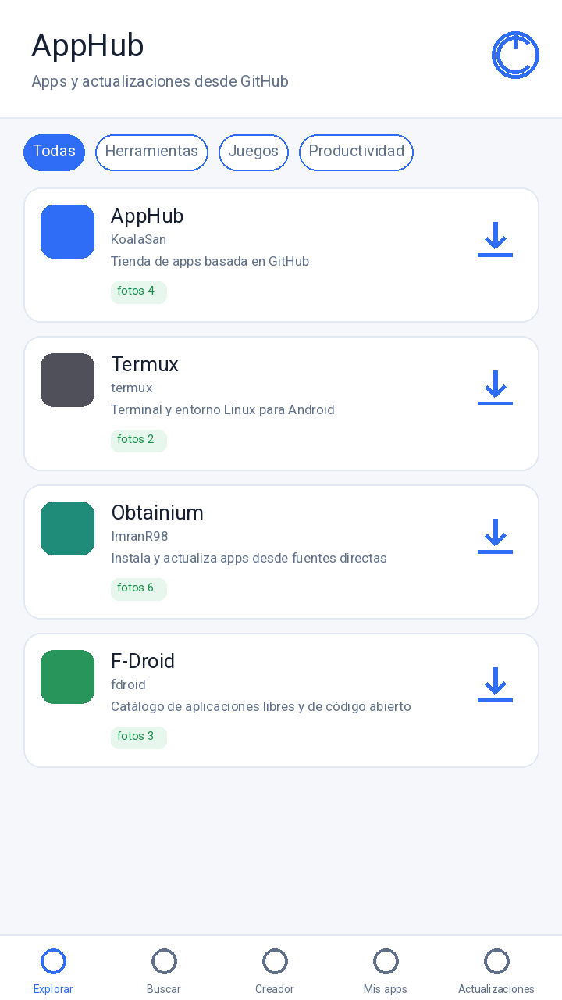
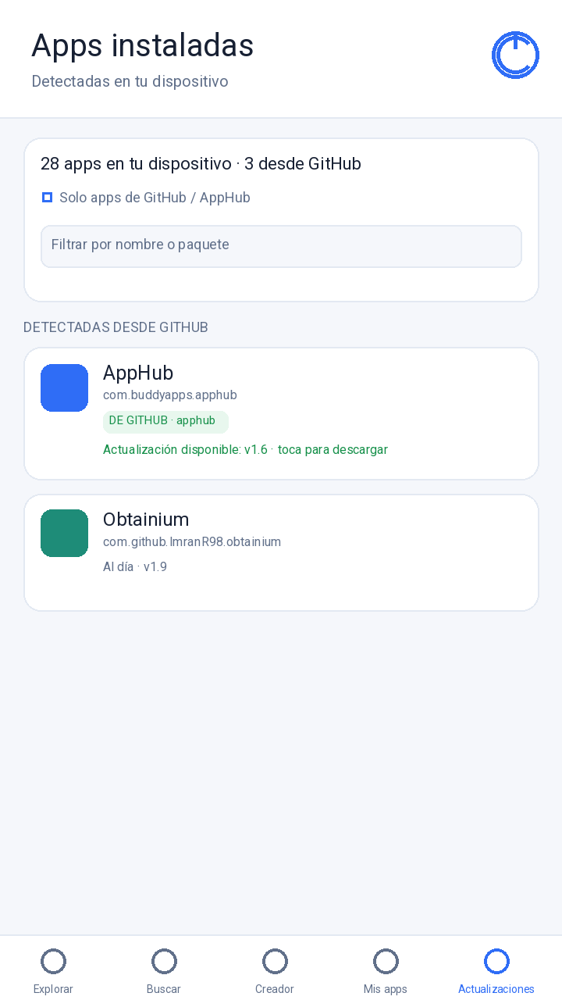
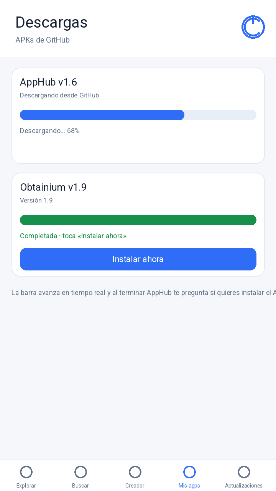

# AppHub

[](LICENSE)
[](https://www.android.com/)
[](https://developer.android.com/)
[](https://www.java.com/)
[](https://github.com/KoalaSan/apphub/releases)

Una tienda de aplicaciones para Android basada en GitHub. Descubre proyectos con APK publicados, instálalos, recibe actualizaciones y publica los tuyos propios desde la app. Funciona sin cuenta: el navegador anónimo de GitHub es suficiente para explorar y descargar.

## Vistas de la interfaz

| Explorar | Actualizaciones | Descargas |
|---|---|---|
|  |  |  |

Estas imágenes son una representación de la interfaz de la app; el aspecto final puede variar ligeramente según el dispositivo y la versión de Android.

## Qué hace

- **Explorar** apps reales de GitHub mediante búsquedas por temas (`topic:android-app topic:apk`), con paginación al pulsar actualizar.
- **Categorías** para filtrar: Herramientas, Juegos, Productividad, Educación, Entretenimiento, Salud, Finanzas, Personalización y Más.
- **Buscar** por texto y por desarrollador, combinando ambos filtros.
- **Creador**: catálogo público de las apps que el autor va publicando; visible para cualquiera que use AppHub.
- **Mis apps**: tus repositorios de GitHub usando tu token (se guarda solo en el dispositivo).
- **Ficha de cada app**: descripción del README, capturas, licencia, lenguaje, temas, forks e incidencias.
- **Descargas** con barra de progreso en vivo y diálogo «¿Instalar ahora?» al terminar, con notificación de respaldo.
- **Actualizaciones tipo Play Store**: escanea las apps instaladas en el dispositivo, reconoce las que vienen de GitHub o de AppHub y compara su versión con el último release.

## Cómo reconoce las apps instaladas

AppHub cruza tres fuentes para saber si una app del dispositivo viene de GitHub:

1. El paquete del APK se lee del archivo descargado y se guarda como «pendiente de instalar».
2. Un receptor del sistema confirma cuándo esa app se instala realmente (`PACKAGE_ADDED` / `PACKAGE_REPLACED`).
3. El catálogo público (`catalog.json`) incluye el `packageName` de cada app publicada, así que una app instalada por otro medio (por ejemplo, desde el navegador) también se reconoce.

Si una app no se detecta automáticamente, mantén pulsada su fila en «Apps instaladas» e indica el repo `owner/nombre` a mano.

## Instalación

Descarga el APK desde la [última release](https://github.com/KoalaSan/apphub/releases/latest) e instálalo. Android pedirá permiso de «instalar apps desconocidas»; AppHub te lleva al ajuste correspondiente.

Requisitos: Android 8.0 (API 26) o superior.

## Publicar una app desde la app

1. Añade tu token de GitHub en **Mis apps → Conectar GitHub**. El token necesita permiso de escritura en `KoalaSan/apphub` para publicar en el catálogo.
2. Ve a **Creador → Publicar una app**, elige uno de tus repositorios y ponle nombre, descripción y categoría.
3. La versión y el APK se toman automáticamente del último release de GitHub con un asset `.apk`.
4. Se escribe en [`catalog.json`](catalog.json) mediante la API de contenidos de GitHub. Cualquier usuario de AppHub lo verá en la pestaña Creador.

El token nunca se envía a ningún servidor propio: solo se usa directamente contra `api.github.com` desde el dispositivo.

## Compilar

El proyecto es Java plano sin AndroidX ni Gradle; se construye con la toolchain de Buddy:

```sh
bash /root/.buddy/work/.claude/skills/android-app/build-apk.sh /root/.buddy/work/apphub
```

El APK firmado se genera en `build/app.apk`.

## Licencias

- **Código de AppHub**: [MIT](LICENSE) · Copyright (c) 2026 KoalaSan.
- **Dependencias de terceros**: no hay bibliotecas externas; se usan únicamente Android SDK y las clases del framework. Detalles en [THIRD_PARTY_NOTICES.md](THIRD_PARTY_NOTICES.md).
- Las apps que aparecen en la tienda son obra de sus respectivos autores y se distribuyen bajo sus propias licencias, que se muestran en la ficha de cada una cuando GitHub las declara.

## Aviso

AppHub es un cliente de GitHub Releases: no aloja, modifica ni verifica los APK de terceros. Descarga bajo tu responsabilidad y revisa siempre el permiso de instalación del sistema.
